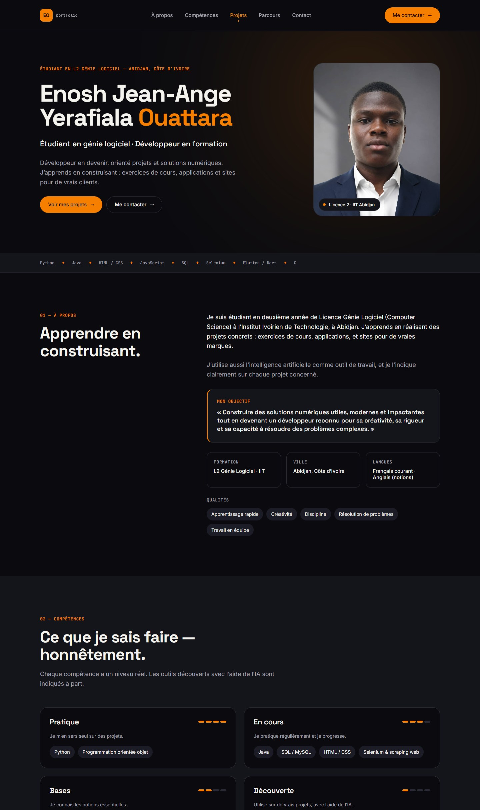

# Portfolio — Enosh Jean-Ange Yerafiala Ouattara

Portfolio personnel d'un étudiant en **Licence 2 Génie Logiciel (Computer Science)** à l'Institut Ivoirien de Technologie, Abidjan.
Site statique en **HTML, CSS et un peu de JavaScript**, construit à l'identique de sa maquette.



## 🎨 La maquette

La maquette a été conçue avant le code, en deux formats, puis importée dans Canva :

| Version | PDF (pleine page) | Image |
|---|---|---|
| Ordinateur — 1440 px | [maquette/ordinateur-1440.pdf](maquette/ordinateur-1440.pdf) | [maquette/ordinateur-1440.png](maquette/ordinateur-1440.png) |
| Téléphone — 390 px | [maquette/telephone-390.pdf](maquette/telephone-390.pdf) | [maquette/telephone-390.png](maquette/telephone-390.png) |

Aperçus découpés : [ordinateur 1](maquette/apercu-ordinateur-partie-1.jpg) · [2](maquette/apercu-ordinateur-partie-2.jpg) · [3](maquette/apercu-ordinateur-partie-3.jpg) — [téléphone 1](maquette/apercu-telephone-partie-1.jpg) · [2](maquette/apercu-telephone-partie-2.jpg) · [3](maquette/apercu-telephone-partie-3.jpg) · [4](maquette/apercu-telephone-partie-4.jpg)

<!-- Lien Canva : à ajouter ici une fois la maquette importée dans Canva -->

## 📁 Organisation du dossier

```
portfolio/
├── site/                 ← le site (c'est ce dossier qu'on met en ligne)
│   ├── index.html        ← le contenu : 7 sections
│   ├── styles.css        ← couleurs, polices, mise en page, version téléphone
│   ├── script.js         ← menu téléphone, filtres, animations, lien actif
│   └── assets/           ← la photo
├── maquette/             ← la maquette (PDF + images) ordinateur et téléphone
├── outils/exporter.mjs   ← génère la maquette (PDF/PNG) avec Chrome
├── figma-plugin/         ← première tentative : plugin qui dessinait la maquette dans Figma
└── CONTENU.md            ← tous les textes validés du portfolio
```

## 🧱 Les sections du site

1. **Accueil** — nom, titre de profil, phrase d'accroche, photo, boutons « Voir mes projets » et « Me contacter »
2. **À propos** — formation, objectif, langues, qualités
3. **Compétences** — 4 niveaux honnêtes : Pratique, En cours, Bases, Découverte (avec l'aide de l'IA)
4. **Projets** — 10 projets avec leur statut réel et des filtres (Tous / Terminés / En cours)
5. **Parcours** — BEPC, BAC, Licence 1, Licence 2
6. **Contact** — e-mail, WhatsApp, GitHub, LinkedIn
7. **Pied de page** — navigation et retour en haut

## ▶️ Voir le site sur son ordinateur

Double-cliquer sur `site/index.html` : il s'ouvre dans le navigateur. Aucune installation n'est nécessaire.

Pour régénérer la maquette après une modification (Node.js et Google Chrome nécessaires) :

```powershell
node outils/exporter.mjs
```

## 🛠️ Technologies

- **HTML5** sémantique (header, nav, main, section, article, footer)
- **CSS3** : variables de couleurs, Flexbox, Grid, media queries (1100 px et 760 px), animations
- **JavaScript** sans bibliothèque : `IntersectionObserver` pour les apparitions et le lien actif
- Polices Google Fonts : Space Grotesk (titres), Inter (texte), JetBrains Mono (code)
- Accessibilité : contrastes vérifiés, navigation au clavier, `aria-label`, respect de « réduire les animations »

## 📬 Contact

- E-mail : enoshouattara@gmail.com
- GitHub : [enoshouattara-svg](https://github.com/enoshouattara-svg)
- LinkedIn : [enosh-ouattara](https://www.linkedin.com/in/enosh-ouattara-2708643b0/)

---
© 2026 Enosh Ouattara — certains projets présentés ont été réalisés avec l'aide de l'IA, comme indiqué sur chacun.
